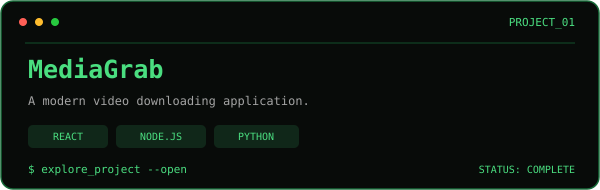
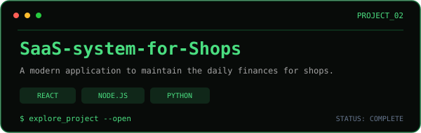

<!-- ========== HEADER ========== -->


<div align="center">


<br/>

# `> Hello, World!` 👋

### **Md. Khalid Bin Sayed Shihab**


<br/>

`< _building />` `</ _testing >` `< _improving />`

<br/>

**Think. Code. Test. Repeat.**

<br/>


</div>


<!-- ========== ABOUT ========== -->

## `01 // WHOAMI`

```bash
$ whoami
Md. Khalid Bin Sayed Shihab

$ current_role
Jr. SQA Engineer @ ATI Limited

$ mission
Building reliable software and testing beyond the obvious.

$ current_focus
 Software Quality | Automation Testing | Performance Testing | Security Testing | AI Innovation

$ philosophy
"If users feel friction, I treat it as a bug."
```

## `02 // TECH_STACK`

**Languages & Development**


**Software Quality Assurance**


## `03 // FEATURED_PROJECTS`

<div align="center">

<a href="https://github.com/Shihab2001/MediaGrab-Video-downloader">
  
</a>

<br/>

<a href="https://github.com/Shihab2001/SaaS-system-for-Shops">
  
</a>

<br/>

<!-- <a href="YOUR_POCKET_LEDGER_REPOSITORY_URL">
  
</a>

</div> --> 


## `04 // GITHUB_ANALYTICS`

<div align="center">


</div>


## `05 // CONTRIBUTION_ACTIVITY`

<div align="center">


</div>


## `06 // CONNECT_WITH_ME`

<div align="center">

[]([YOUR_LINKEDIN_URL](https://www.linkedin.com/in/khalid-bin-sayed-shihab/))
[](https://khalidbinsayed.com)
[](https://github.com/Shihab2001)

</div>

---

<div align="center">

```bash
> while(alive) {
    learn();
    build();
    test();
    repeat();
}
```

**Thanks for visiting my profile!**


</div>
